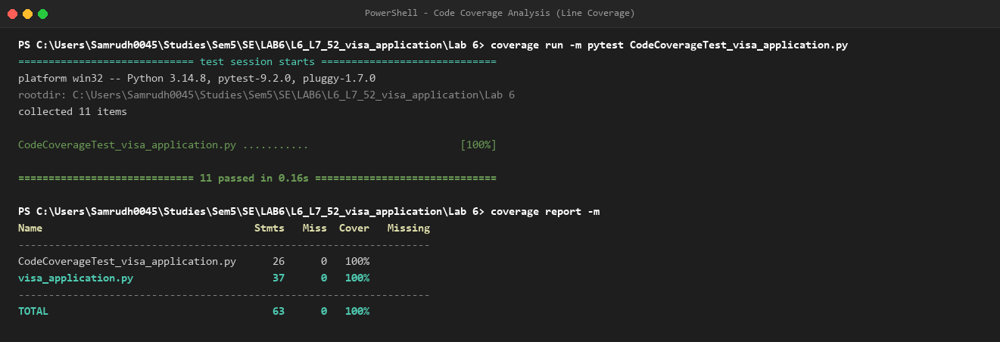
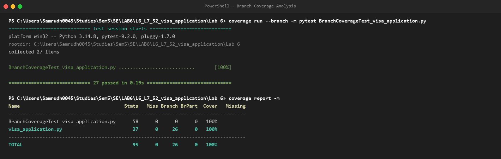

# Lab 6: Code and Branch Coverage Analysis

**Student SRN:** PES1UG24CS417  
**Module:** Software Engineering Lab  

---

## 1. Overview & Objective

This lab focuses on measuring, analyzing, and maximizing test coverage using Python's `coverage` and `pytest` frameworks:
- **Code Coverage (Line Coverage):** Ensures that every statement in the code under test executes at least once.
- **Branch Coverage:** Ensures that every decision point (`if`, compound conditions, and loop structures) evaluates to both `True` and `False`, testing all logical pathways through the application.

Application under test: [`visa_application.py`](visa_application.py) — calculates visa fees by visa type, entry count, processing speed, and nationality group, verifies document completeness, and calculates application status based on remaining days and season.

---

## 2. Deliverables Summary

| File | Description | Target Coverage | Achieved Coverage |
| :--- | :--- | :--- | :--- |
| [`CodeCoverageTest_visa_application.py`](CodeCoverageTest_visa_application.py) | Test cases targeting line/statement coverage | $\ge 90\%$ | **100% Statements** (37/37) |
| [`code_coverage_screenshot.png`](code_coverage_screenshot.png) | Terminal output screenshot for code coverage | - | Verified |
| [`BranchCoverageTest_visa_application.py`](BranchCoverageTest_visa_application.py) | Comprehensive test cases targeting all decision branches | $\ge 90\%$ | **100% Branches** (26/26 branches) |
| [`branch_coverage_screenshot.png`](branch_coverage_screenshot.png) | Terminal output screenshot for branch coverage | - | Verified |
| [`test_visa_application.py`](test_visa_application.py) | Complete test suite covering all branches and edge cases | $\ge 90\%$ | **100% Statements & Branches** |

---

## 3. Coverage Reports & Terminal Outputs

### A. Code Coverage (Line Coverage: 100%)

Command used:
```bash
coverage run -m pytest CodeCoverageTest_visa_application.py
coverage report -m
```

```text
Name                                   Stmts   Miss  Cover   Missing
--------------------------------------------------------------------
CodeCoverageTest_visa_application.py      26      0   100%
visa_application.py                       37      0   100%
--------------------------------------------------------------------
TOTAL                                     63      0   100%
```



---

### B. Branch Coverage (Branch Coverage: 100%)

Command used:
```bash
coverage run --branch -m pytest BranchCoverageTest_visa_application.py
coverage report -m
```

```text
Name                                     Stmts   Miss Branch BrPart  Cover   Missing
------------------------------------------------------------------------------------
BranchCoverageTest_visa_application.py      58      0      0      0   100%
visa_application.py                         37      0     26      0   100%
------------------------------------------------------------------------------------
TOTAL                                       95      0     26      0   100%
```



---

## 4. Key Takeaways: Line Coverage vs. Branch Coverage

1. **Line Coverage (100%)** guarantees each line was executed, but does not guarantee every logical condition evaluated to both branches. For instance, an `if extra > 5:` block can execute all lines when `extra = 7` with `speed == "express"`, but fails to test when `extra > 5` with `speed == "normal"` (missing branch `21->23`).
2. **Branch Coverage (100%)** forces testing both sides of compound conditions (e.g. `nationality_group == "A" and visa_type != "student"`) and all boundary conditions across normal and express speeds, ensuring zero untested execution paths.
